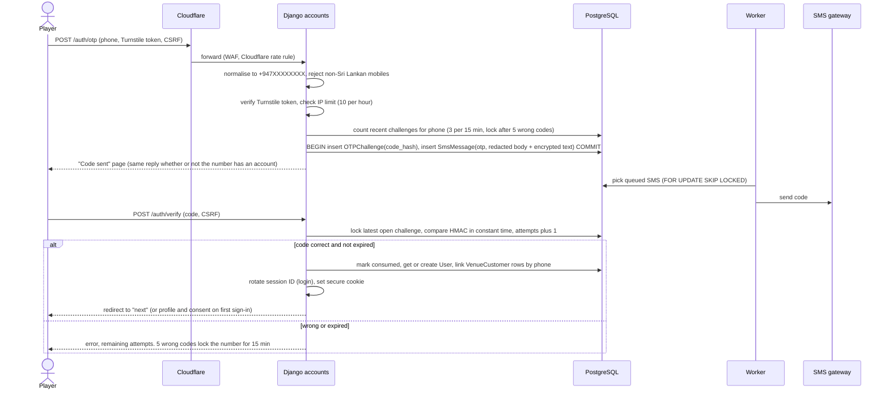
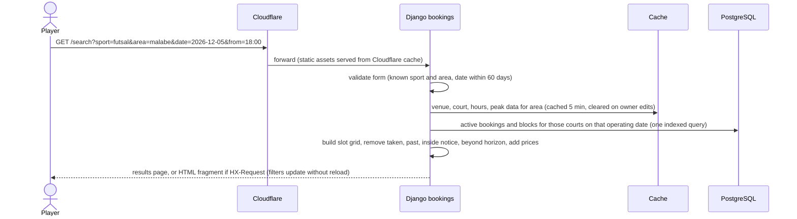
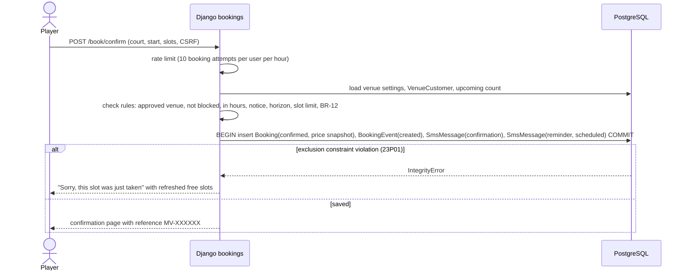
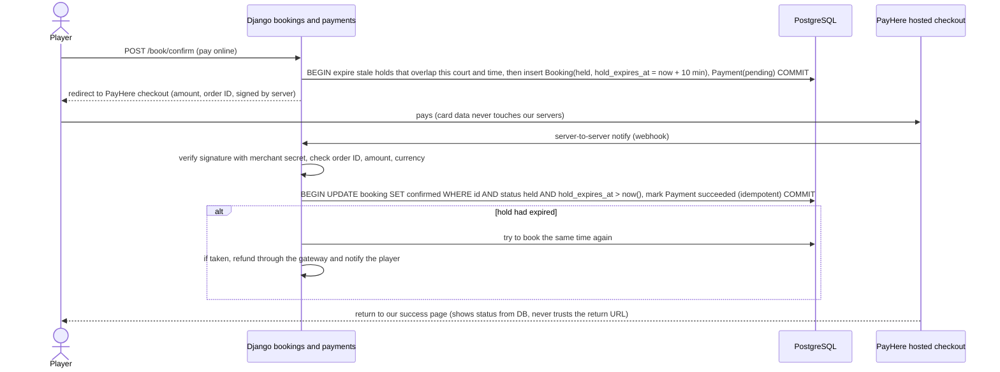
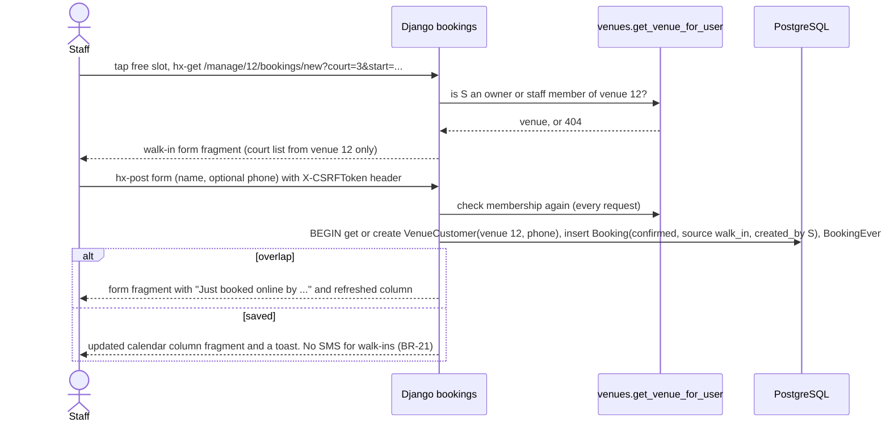

# Matchvia Architecture

Version 1.0 · 26 Nov 2026 · Based on [proposal.md](proposal.md), [requirements.md](requirements.md) v1.0,
[data-model.md](data-model.md) v1.0 and [CLAUDE.md](../CLAUDE.md)

This document describes how the system is built, deployed, secured and tested. Decisions that need
the founders are collected in **section 9**, each with a recommended default. Rule and story IDs refer
to [requirements.md](requirements.md).

---

## 1. Overview

```
 Phone browser / installed PWA
        │  HTTPS
        ▼
 Cloudflare (DNS, TLS, CDN for static files, WAF, Turnstile, Access for admin)
        │  HTTPS, origin accepts Cloudflare IPs only
        ▼
 ┌───────────────────── App server (staging and production each) ─────────────────────┐
 │  Caddy (TLS to Cloudflare)                                                         │
 │    └─► Gunicorn ── Django 6.1 (one codebase: player site, venue dashboard, admin)   │
 │  Worker process ── `manage.py run_worker` (SMS outbox, reminders, expiries)        │
 └──────────────────────────────────────┬─────────────────────────────────────────────┘
                                        │ TLS
                     ┌──────────────────┴──────────────────┐
                     ▼                                     ▼
          Managed PostgreSQL (btree_gist)        Object storage (venue photos)
          daily backups + point-in-time

 Outside services: SMS gateway (Text.lk), Sentry (errors), uptime monitor, PayHere (Phase 2)
```

**Shape of the system.** One Django project, server-rendered HTML with HTMX for partial updates,
one PostgreSQL database, and one background worker process. There is no separate front-end app, no
API server, no Redis and no message broker. Every extra moving part costs money and attention, and
none of them is needed for 200 venues (NFR-08).

**Trade-off:** a single deployable unit is the cheapest and simplest option for one developer. The cost is
that a later native app (Phase 4) needs an API layer added. Business logic sits in `services.py`, so
that API can call the same functions.

---

## 2. Django apps and responsibilities

### 2.1 Repository layout

```
matchvia/                      repository root
├── config/                    project package
│   ├── settings/              base.py, dev.py, test.py, staging.py, prod.py
│   ├── urls.py  wsgi.py  asgi.py
├── core/                      shared code, no models of its own
├── accounts/  venues/  pricing/  bookings/  teams/
├── notifications/  payments/  reports/  adminpanel/
├── templates/                 base layout, shared partials
├── static/                    Tailwind source, vendored htmx and Leaflet, PWA icons
├── locale/                    translations (si later)
├── docs/
├── pyproject.toml  uv.lock    dependencies (section 9.2)
├── Dockerfile  compose.yaml   same image in staging and production
└── .env.example               every setting name, no values
```

Each app has `models.py`, `services.py` (business logic), `selectors.py` (read queries, optional),
`views.py` (thin: parse request → call service → render), `forms.py`, `urls.py`, `admin.py`,
`templates/<app>/` and `tests/`.

### 2.2 Responsibilities

| App | Owns (models) | Responsible for | Requirements |
|---|---|---|---|
| `core` | none | Phone normalisation (E.164), operating-day and operating-minute helpers, `VenueOwnedQuerySet`, domain exceptions (`SlotTaken`, `RuleViolation`, `NotAllowed`), rate-limit decorators, request-ID logging, HTMX helpers | Cross-cutting |
| `accounts` | `User`, `OTPChallenge`, `ConsentRecord` | OTP request/verify, sign-in/out, first-time profile and consent, account deletion and anonymisation, session policy | FR-01, US-P01, US-P08, NFR-07 |
| `venues` | `Area`, `Venue`, `VenueSettings`, `VenueMembership`, `VenuePhoto`, `Court`, `OpeningHours`, `VenueCustomer` | Venue registration and setup, courts, hours, settings, staff, customer book, player blocking, public venue page, **the venue access check `get_venue_for_user()`** | FR-02, FR-03, FR-15, US-O01–O06, US-O08, US-O09 |
| `pricing` | `PeakPeriod` | Price for a court at a start time; peak period setup | FR-03, BR-18 |
| `bookings` | `Booking`, `BookingEvent`, `RecurringSeries` | Free-slot calculation, search, booking/cancel/move/no-show, blocks and closed dates, recurring series, holds (Phase 2), audit trail | FR-04–FR-11, FR-14, NFR-01 |
| `teams` | `Team`, `TeamMembership`, `TeamInvite` | Teams, invites, team bookings view | FR-13, US-C01–C03, US-P09 |
| `notifications` | `SmsMessage` | Outbox, SMS templates, gateway adapter, the worker's send loop, reminder scheduling | FR-05, FR-10, NFR-03 |
| `payments` | (`Payment`, Phase 2) | Hosted checkout and verified webhooks. **Not created until Phase 2** | FR-16–FR-18 |
| `reports` | none | Phase 2 reports. **Not created until Phase 2** | FR-21 |
| `adminpanel` | `AdminAccessLog` | Django admin customisation for platform admins: superuser-only admin site with two-step sign-in, admin home counts, venue approval/suspension actions, area list, booking lookup by reference or phone, access logging, deletion on request | FR-12, US-A01–A04 |

### 2.3 Rules between apps

- **Dependency direction:** `core` ← `accounts` ← `venues` ← `pricing` ← `bookings` → `notifications`;
  `teams` depends on `accounts`. No cycles. `notifications` refers to bookings by foreign key string,
  never imports booking logic.
- **Cross-app calls go through `services.py`** (for example `bookings` calls
  `notifications.services.queue_sms(...)` and `pricing.services.price_for(...)`), never through
  another app's views or by writing another app's models directly.
- **No Django signals for business logic.** Calls are explicit, so the order of steps inside a
  transaction is visible and testable. Signals are allowed only for framework plumbing.
- **Services own transactions.** A service function takes the acting user (and venue for venue-side
  work), validates the business rules, writes inside `transaction.atomic()`, queues SMS in the same
  transaction, writes the audit event, and raises a domain exception on failure. Views translate
  exceptions into messages.

### 2.4 URL map

| Area | Prefix | Who |
|---|---|---|
| Search and home | `/`, `/search/` | Public |
| Venue public page | `/v/<slug>/` | Public |
| Sign-in | `/auth/` | Public, rate-limited |
| Player area | `/me/` (bookings, teams, account) | Signed-in user |
| Booking flow | `/book/` | Signed-in user |
| Venue dashboard | `/manage/<venue_id>/...` (calendar, bookings, blocks, customers, series, settings, staff) | Venue members, checked on every request |
| Platform admin | `/ops-<random>/` (Django admin) | Platform admins, behind Cloudflare Access |
| Health | `/healthz` | Monitoring |

HTMX requests hit the same views; views return a partial template when the `HX-Request` header is set.

---

## 3. Request flows

### 3.1 Phone OTP login (US-P01)



Key points:
- The 6-digit code comes from `secrets.randbelow`. Only `HMAC-SHA256(OTP_HMAC_KEY, challenge_id +
  code)` is stored. Comparison uses `hmac.compare_digest`.
- Only Sri Lankan mobile numbers (`+947…`) are accepted. That blocks **SMS pumping fraud** (bots
  sending OTPs to premium international numbers at our cost).
- The OTP SMS is sent by the worker in seconds, not inside the request, so a slow gateway never
  blocks the page. If the worker finds an OTP message older than 5 minutes it drops it (the code
  has expired anyway).
- The outbox stores the OTP text **encrypted** (Fernet; key derived from `OTP_HMAC_KEY`), readable
  for 5 minutes and wiped once sent or dropped; the visible `body` is `[OTP]` (data-model 3.6).
- In development the console SMS backend prints messages in the worker's terminal
  (`manage.py run_worker`); it refuses to start unless `DEBUG` is on.
- The `next` redirect only accepts local paths (`url_has_allowed_host_and_scheme`), so the login
  cannot become an open redirect.

### 3.2 Searching free slots (US-P02, US-P03)



- **Availability is never cached.** Only slow-changing venue data is, and owner edits clear it.
  The booking path always reads the database (proposal 6.4).
- Search is a `GET` with no side effects, and it is rate-limited per IP (60 per minute) against
  scraping.
- Target: under 2 seconds on 4G (NFR-02). Pages are server-rendered HTML; HTMX is about 15 KB; there
  is no client framework.

### 3.3 Booking, with the Phase 2 hold (US-P04, BR-07)

**MVP (pay at venue, no hold):**



**Phase 2 (online payment with a 10-minute hold):**



- The return URL the player lands on is **never** treated as proof of payment. Only the verified
  webhook confirms (CLAUDE.md rule 6).
- Webhooks are idempotent: a repeated notification for an already-confirmed order changes nothing.
- The webhook endpoint is the only view without a browser session. It is protected by signature
  verification, not by CSRF tokens, and it does **not** use `csrf_exempt` on any other view.
  (Django needs `csrf_exempt` on this single endpoint because the gateway cannot send a CSRF token.
  This is the one allowed exception to CLAUDE.md rule 3, documented in section 9.3.)

### 3.4 Staff adds a walk-in (US-S02)



- Three taps: free slot → name → Save (NFR-04).
- The venue ID in the URL is only a hint. Access is decided by the membership check, and every query
  uses `for_venue(venue)`. Venue 13's court ID in a tampered POST fails form validation because the
  court field's queryset is scoped to venue 12.
- The calendar polls for changes every 30 seconds while open (`hx-trigger="every 30s"`, a small
  fragment), so new online bookings appear without a reload. Server push (SSE/WebSockets) is not
  worth it at this scale.

---

## 4. Background jobs

### 4.1 Design

A single long-running worker process, `python manage.py run_worker`, runs a loop. It runs in the same
Docker image as the web app and is restarted automatically if it exits.

| Job | Every | What it does |
|---|---|---|
| `send_sms` | 5 s | Sends due `queued` SMS (`scheduled_for <= now()`), oldest first, in batches of 20 |
| `expire_holds` | 60 s | Phase 2: `held` → `expired` for holds past `hold_expires_at` |
| `expire_series_requests` | 15 min | `pending` recurring requests past 48 h → `expired`, notify captain |
| `expire_team_invites` | 1 h | Pending invites past 7 days → `expired` |
| `purge_personal_data` | once a day (first pass, then every 24 h) | Delete OTP rows older than 24 h; blank `to_phone` on SMS older than 90 days |
| `heartbeat` | every pass (5 s) | Writes the worker's last-seen time to the cache; `/healthz` fails in staging/production when it is older than 120 s |

The queue **is the database**: SMS rows are the outbox (data-model 3.6), and expiries are queries on
indexed columns. Rows are claimed with `SELECT … FOR UPDATE SKIP LOCKED`, so two worker processes
(for example during a deploy) never send the same message twice from one claim.

**Trade-off:**

| Option | Verdict |
|---|---|
| Database-polling worker (chosen) | No extra service to host, pay for or secure. The outbox is written in the booking transaction, so jobs can't be lost. Polling every 5 s is trivial load at this scale |
| Celery + Redis | Industry standard, but adds Redis hosting, a broker to monitor, and a second source of truth. Worth it only at much higher volume |
| Django's built-in Tasks framework (`django.tasks`) | Good for enqueueing one-off tasks, but it doesn't schedule periodic jobs, and production use needs a third-party worker backend. Revisit when a database backend is mature; our job functions can be moved onto it without changing callers |
| Cron + management commands | Fine for daily jobs, but one-minute granularity is too slow for OTP SMS |

### 4.2 Failing safely

| Failure | What happens | Why it is safe |
|---|---|---|
| SMS gateway down or slow | Request returns normally. The worker retries with backoff (1, 5, 15, 30 min), then marks `failed` after 5 attempts and logs an error to Sentry | Bookings never wait for SMS (NFR-03). The confirmation screen and "My bookings" always show the booking |
| Worker crashes mid-send | The claim transaction rolls back; the message returns to `queued` and is retried | **At-least-once delivery**: a rare duplicate SMS is better than a lost one. The gateway call has a 10 s timeout so a claim never hangs |
| Worker down for a long time | Heartbeat goes stale → `/healthz` fails → uptime monitor alerts the founder's phone | On restart: OTP messages older than 5 min are dropped (code expired); reminders for games that already started are cancelled instead of sent late; confirmations still go out |
| Hold expiry job late (Phase 2) | Stale holds are released on contact by the booking service, and treated as free by availability reads (data-model 4.3) | The job is housekeeping, not what keeps bookings correct |
| Booking cancelled or moved after reminder was queued | The same transaction cancels or reschedules the queued reminder (unique reminder per booking) | No reminders for cancelled games |
| Job raises an exception | Each job runs in its own `try` with its own transaction; the loop logs and continues | One bad row cannot stop SMS for everyone |
| Two workers running | `SKIP LOCKED` claims; expiry updates are idempotent (`WHERE status = 'held' AND …`) | No double processing |

---

## 5. Security plan (OWASP Top 10:2021)

The 2025 edition of the OWASP Top 10 reorders these and adds software supply-chain failures and
mishandling of exceptional conditions. Both are covered below (A06/A08 and section 4.2).

| OWASP | Risk for Matchvia | Controls |
|---|---|---|
| **A01 Broken access control** | Staff of venue A reading or changing venue B's bookings or customer phones; players seeing other players' bookings; IDOR via IDs in URLs | One entry point `get_venue_for_user(user, venue_id, roles)` → 404 when not a member; every venue query via `.for_venue(venue)`; form querysets scoped to the venue; owner-only actions checked by role; player views filter by `request.user`; composite FKs in the database (data-model 6.3); **an isolation test for every venue-side URL**, enforced by a test that fails when a new URL has none (CLAUDE.md rule 2) |
| **A02 Cryptographic failures** | Interception of sessions or OTPs; leaked database exposing codes or tokens | HTTPS everywhere, HSTS (1 year, include subdomains, preload after pilot); Cloudflare "Full (strict)" TLS to origin; TLS to the database; OTP codes stored as HMAC; invite tokens as SHA-256; `SECRET_KEY` and `OTP_HMAC_KEY` separate and environment-only; encrypted backups |
| **A03 Injection (SQL, XSS)** | SQL injection through search filters; stored XSS through venue names, customer names, notes | ORM only; any raw SQL uses parameters (CLAUDE.md rule 3), reviewed in PRs. Django autoescaping always on; **no `mark_safe`/`|safe` on user input**; `json_script` for data passed to JS; no inline event handlers. **CSP** (Django's built-in CSP support) with `default-src 'self'`, script and style nonces, no `unsafe-inline`, no `unsafe-eval`; htmx configured with `allowEval = false` and `includeIndicatorStyles = false`; all JS/CSS vendored and self-hosted (no CDNs); `img-src` allows only our storage domain and OpenStreetMap tiles |
| **A04 Insecure design** | Double bookings under load; abuse of free cancellation; fake bookings with no deposit | Exclusion constraint (NFR-01) plus concurrency test; per-player booking limits (BR-12); venue blocking (BR-11); one hold per user (Phase 2); business rules from requirements tested one by one |
| **A05 Security misconfiguration** | `DEBUG=True` in production; open admin; permissive hosts; origin reachable around Cloudflare | Separate settings modules; `manage.py check --deploy` must pass in CI against prod settings; `ALLOWED_HOSTS` and `CSRF_TRUSTED_ORIGINS` exact; secure, HttpOnly, SameSite=Lax cookies; `X-Frame-Options: DENY`; `Referrer-Policy: same-origin`; admin at a non-default path **behind Cloudflare Access**; origin firewall accepts HTTP(S) only from Cloudflare IP ranges, SSH only by key; staging also behind Cloudflare Access |
| **A06 Vulnerable and outdated components** | Old Django or library with a known CVE | Locked dependencies (`uv.lock`); `pip-audit` in CI; Dependabot weekly PRs; Django security releases applied within 7 days; plan for Django 6.2 LTS (proposal 6.5); OS image rebuilt monthly |
| **A07 Identification and authentication failures** | OTP brute force; SMS bombing a victim's phone; session theft; SIM-swap | OTP rules BR-27 (5 min, 5 attempts, 3 per 15 min per number, 10 per hour per IP); Turnstile on the OTP form; Cloudflare rate-limiting rule on `/auth/`; identical response for known and unknown numbers; session ID rotated at login; session lifetimes in 9.1 (D9); removing staff kills access on the next request; global daily OTP budget alarm. **Admin site:** active superusers only; sign-in is mobile number + password (12+ characters) and then a 6-digit SMS code (OTP purpose `admin_login`); 20 password attempts per IP per hour; 5 wrong passwords lock that number's admin sign-in for 15 minutes; failures logged with the number masked; a verified admin session lasts 8 hours (checked on every request, not only by cookie age) |
| **A08 Software and data integrity failures** | Forged payment webhooks; tampered prices from the browser; compromised CI | Prices always recalculated on the server, never taken from the form; webhook signature + amount + order check (Phase 2); deployments only from CI artefacts built from `main`; GitHub branch protection and required checks; Actions pinned to commit SHAs; secrets in GitHub Environments with production approval |
| **A09 Logging and monitoring failures** | Attacks or outages unnoticed; personal data leaking into logs | Structured JSON logs with request ID; security events logged (sign-in success/failure, OTP lock, rate-limit hit, 404 on another venue's object, admin access, staff added/removed, price change); **never log OTP codes, tokens, session IDs or full phone numbers** (masked `+9477****567`); Sentry with `send_default_pii=False` and scrubbing; uptime and worker-heartbeat alerts to phone; logs kept 30 days |
| **A10 Server-side request forgery** | Server fetching attacker-supplied URLs | The app never fetches user-supplied URLs. Outbound calls go only to fixed hosts (SMS gateway, PayHere, Sentry) from settings. Image uploads are processed locally (Pillow), never fetched by URL |

### 5.1 Additional controls

**File uploads (venue photos, logos).** Accept JPEG/PNG/WebP up to 5 MB; open with Pillow and re-encode
(this strips EXIF data, including GPS); random file names; stored in object storage on a separate
domain; never served from the app domain; maximum image dimensions enforced to stop decompression
bombs.

**Rate limits (CLAUDE.md rule 4).**

| Endpoint | Limit | Store |
|---|---|---|
| OTP request | 3 per number per 15 min; 10 per IP per hour; Turnstile | `OTPChallenge` table + cache |
| OTP verify | 5 wrong codes per number → 15 min lock; 30 per IP per hour | `OTPChallenge` + cache |
| Booking create/cancel | 10 per user per hour | Cache |
| Team invites | 20 per captain per day | Cache |
| Search | 60 per IP per minute | Cache |
| Everything | Cloudflare WAF managed rules and one rate-limit rule on `/auth/` | Cloudflare |

The cache is Django's database cache (`DatabaseCache`), which works across all web and worker
processes with no Redis. The client IP is read from `CF-Connecting-IP` **only** because the origin
firewall accepts traffic from Cloudflare alone; otherwise that header could be forged to dodge limits.

**CSRF with HTMX.** `CsrfViewMiddleware` on; the base template sets
`hx-headers='{"X-CSRFToken": "{{ csrf_token }}"}'` on `<body>`, so every HTMX request carries the
token. All state changes are `POST`. No `csrf_exempt` anywhere except the Phase 2 payment webhook
(section 3.3).

**Secrets (CLAUDE.md rule 5).** All secrets come from environment variables, read once in settings;
the app refuses to start in staging/production if any required one is missing. Required:
`SECRET_KEY`, `OTP_HMAC_KEY`, `DATABASE_URL`, `ALLOWED_HOSTS`, `SMS_API_KEY`, `SMS_SENDER_ID`,
`TURNSTILE_SITE_KEY`, `TURNSTILE_SECRET_KEY`, `STORAGE_*` keys, `SENTRY_DSN`, later
`PAYHERE_MERCHANT_ID`, `PAYHERE_MERCHANT_SECRET`. Staging and production have **different** values
for every secret. On the server they live in a root-owned `.env` file (mode 600) outside the
repository, with a copy in a password manager shared by the two founders. `gitleaks` runs in CI and
as a pre-commit hook. Rotation: immediately on any suspected leak or when someone with access leaves;
`SECRET_KEY` rotation uses `SECRET_KEY_FALLBACKS` so users aren't logged out.

**Backups.**

| What | How | Kept | Restore test |
|---|---|---|---|
| Production database | Managed PostgreSQL daily backups + point-in-time recovery | Per provider (7 days typical) | – |
| Independent copy | Nightly `pg_dump`, encrypted with `age`, uploaded to object storage at a **different provider** | 30 daily, 12 monthly | **Monthly**: restore into a throwaway database, run a row-count and constraint check script, then delete it (never into staging) |
| Before every migration | Provider snapshot (or `pg_dump`) as a deploy step | 7 days | – |
| Venue photos | Object storage versioning | 30 days | Quarterly spot check |

Backup encryption keys are stored offline by both founders; losing them means losing the backups.

### 5.2 PDPA personal-data handling (CLAUDE.md rule 7, NFR-07)

| Topic | Approach |
|---|---|
| Data inventory | Data-model section 9 lists every personal field and what happens on deletion |
| Minimum data | Phone and name only (BR-24). No email, birthday, ID number, or location tracking |
| Consent and notice | Privacy notice and terms accepted at first sign-in, recorded with version (`ConsentRecord`) |
| Purpose limitation | Phone numbers used only for sign-in, booking messages and venue contact. No marketing SMS in MVP |
| Access | Customer phones visible only to that venue's members, the player and platform admins; admin views logged (`AdminAccessLog`) |
| Deletion | Self-service deletion with OTP, immediate anonymisation (BR-25) |
| Retention | OTP rows 24 h; SMS phone numbers 90 days; logs 30 days; backups 12 months; walk-in customer data per BR-28 (open) |
| Processors | Hosting, database, SMS gateway, Sentry, Cloudflare, object storage: list them in the privacy notice; sign or accept each provider's data processing terms |
| Cross-border transfer | Hosting outside Sri Lanka needs the legal check in decision D2 before real player data is stored |
| Breach response | Written one-page runbook: contain, assess, notify the Data Protection Authority and affected users as the Act and authority rules require (confirm timelines with the lawyer), record the incident |
| Roles | Matchvia is likely the controller for player accounts and a processor for each venue's own customer book. Confirm with the lawyer and reflect it in venue terms |

---

## 6. Hosting

### 6.1 Requirements

- Python runtime (Django, Gunicorn) plus an always-on worker process. This rules out
  serverless-only hosts such as Cloudflare Workers (proposal 6.1).
- Managed PostgreSQL with `btree_gist`, daily backups and point-in-time recovery.
- A region close to Sri Lanka: **India (Mumbai, Bangalore)** or **Singapore**. Round-trip time from
  Colombo is roughly 30–60 ms to India and 60–90 ms to Singapore, both fine for NFR-02.
- Budget: about Rs. 5,000–15,000 per month at launch (proposal 4.5), for staging and production
  together.

### 6.2 Options

Prices are approximate list prices in US dollars at about Rs. 300 per dollar. **Confirm current prices
before choosing.**

| Option | Production | Staging | Approx. monthly total | For | Against |
|---|---|---|---|---|---|
| **A. VPS + managed PostgreSQL, India region** (for example DigitalOcean Bangalore: Droplet + Managed PostgreSQL) | 2 GB VPS (~$12) running Caddy, Gunicorn and the worker in Docker; managed PostgreSQL basic (~$15) | 1 GB VPS (~$6) with PostgreSQL in Docker, reset from seed data | **~$35 ≈ Rs. 10,500** | Lowest latency; managed backups and point-in-time recovery for the data that matters; full control; predictable cost | You maintain the VPS (OS updates, Docker); simple but real ops work |
| **B. PaaS, Singapore region** (for example Render or Railway) | Web service + worker service + managed PostgreSQL (~$7 + $7 + ~$20) | Same, smaller (~$20) | **~$55 ≈ Rs. 16,500** | Git-push deploys, no server to patch, built-in TLS and logs | Over budget with two environments; less control over networking (Cloudflare-only origin is harder); costs grow per service |
| **C. Cheapest VPS, self-managed PostgreSQL** (for example Hetzner Singapore) | One VPS (~$8–15) running everything including PostgreSQL | Second small VPS (~$6) | **~$20 ≈ Rs. 6,000** | Cheapest | You own database backups, upgrades and recovery; one failure takes down app and data together. Risky for a booking system whose value is trust |
| **D. Hosting in Sri Lanka** (local data-centre VPS) | Local VPS; usually self-managed PostgreSQL | Local or cloud | Varies, often higher | Simplest answer to data-localisation questions | Managed PostgreSQL rarely available; backup and support quality vary. Consider only if legal advice (D2) requires local hosting |

**Recommendation: option A** (decision D1). Managed PostgreSQL is where the money is best spent,
because losing booking data is the one failure that ends the business. The app server is stateless
(photos are in object storage), so it can be rebuilt from the Docker image in minutes.

Before the pilot, development runs locally (PostgreSQL in Docker). Production goes live just before
the first pilot venue, in line with "free tiers until about 10 paying venues" (proposal 6.6). Free
web tiers that sleep when idle are not used: a sleeping booking site loses the first booking of
the day.

### 6.3 Shared services

| Need | Choice | Cost |
|---|---|---|
| DNS, TLS, CDN, WAF, bot check, admin protection | Cloudflare free plan (DNS, proxy, managed WAF rules, one rate-limit rule, Turnstile, Access for up to 50 users) | Rs. 0 |
| Venue photos | Cloudflare R2 (S3-compatible, free tier ~10 GB, no egress fees), separate bucket per environment (D7) | ~Rs. 0 at launch |
| Off-site backup copy | A bucket at a **different** provider from the database (for example R2 if the database is on DigitalOcean) | ~Rs. 0–300 |
| Error monitoring | Sentry free developer plan, PII scrubbing on (D8) | Rs. 0 |
| Uptime and heartbeat | Better Stack or UptimeRobot free plan, alerts to phone (D8) | Rs. 0 |
| SMS | Text.lk behind an adapter (D4) | From Rs. 0.64 per SMS |
| Maps | OpenStreetMap tiles via Leaflet, with attribution; switch to a paid tile provider if traffic exceeds the OSM tile policy | Rs. 0 |

### 6.4 Environments

| | Local | CI | Staging | Production |
|---|---|---|---|---|
| Purpose | Development | Automated tests | Demo and pre-release checks | Real venues |
| Settings module | `config.settings.dev` | `config.settings.test` | `config.settings.staging` | `config.settings.prod` |
| Database | PostgreSQL in Docker | PostgreSQL service container | PostgreSQL in Docker on staging VPS | Managed PostgreSQL |
| Data | Seed script | Factories | **Seed and demo data only, never production data** | Real |
| SMS | Console backend (prints) | Fake backend (records) | Real gateway, **only to an allowlist** of founder/tester numbers | Real gateway |
| Access | – | – | Behind Cloudflare Access | Public; admin behind Cloudflare Access |
| Domain | localhost | – | `staging.matchvia.lk` | `matchvia.lk` |
| Deploy | – | – | Automatic on every merge to `main` | Manual approval of the build that passed staging (D6) |

Staging doubles as the **sales demo environment**: the co-founder demos realistic seeded venues on
it (proposal 7.4) without touching real data.

### 6.5 Deployment

1. CI builds one Docker image per commit on `main`, tagged with the commit SHA, pushed to GitHub
   Container Registry.
2. **Staging deploy (automatic):** over SSH, the server pulls the image, runs `migrate`, restarts web
   and worker, then checks `/healthz`.
3. **Production deploy (one click, D6):** GitHub Environment approval → database snapshot →
   `migrate` → rolling restart (Gunicorn graceful reload; worker restart) → `/healthz` check → tag
   the release.
4. **Migrations are backward-compatible** (add columns first, remove in a later release) so the old
   code keeps working during the restart and a rollback doesn't need a database restore.
5. **Rollback:** redeploy the previous image tag. Restore the snapshot only if a migration destroyed
   data.
6. Releases on weekday mornings, away from evening peak play (proposal 8.3).

---

## 7. Front end, PWA and language

- **Templates + HTMX + Tailwind CSS.** Tailwind is built with the **standalone Tailwind CLI** (no
  Node.js in the project or the image); htmx and Leaflet are vendored into `static/` (CSP `'self'`,
  no CDN dependency). Static files are served by WhiteNoise with compression and long cache headers,
  cached at Cloudflare.
- **No inline JavaScript or inline styles** (CSP). Small behaviours live in one `app.js`; data is
  passed with `json_script`. No Alpine.js or other libraries that need `unsafe-eval`.
- **PWA:** web manifest, icons, and a small service worker that caches only static assets and an
  offline page. **HTML pages, availability and anything personal are never cached by the service
  worker**, so nobody sees stale free slots or another person's data on a shared phone.
- **Mobile-first and light:** target under 300 KB for the first load excluding photos (NFR-02);
  images served at mobile sizes with lazy loading.
- **Language:** `gettext`/`` on every user-facing string including SMS templates;
  `LocaleMiddleware`; English in MVP, Sinhala before public launch (NFR-05).
- **Time zone:** `TIME_ZONE = "Asia/Colombo"`, `USE_TZ = True`; all conversions to operating days
  and operating minutes go through `core` helpers so the 03:00 rule lives in one place.

---

## 8. Testing strategy and CI

### 8.1 Test layers

| Layer | What | Tools | When |
|---|---|---|---|
| Unit | Business rules BR-01 to BR-29 one by one: slot grid, operating day, pricing, notice/horizon/limits, cancellation window, no-show timing, recurring expansion, phone normalisation, OTP rules | pytest, `time-machine` for frozen time | Every push |
| Database | Exclusion constraint (overlap rejected, adjacent allowed, cancelled/no-show/expired free the slot, blocks collide with bookings), check constraints, composite FKs | pytest-django on **real PostgreSQL** | Every push |
| Concurrency | 20 threads book the same slot → exactly 1 success; 2 staff move bookings into each other's time | pytest with `transaction=True`, threads | Every push |
| Permissions / isolation | For every venue-side URL: other venue's staff → 404 and no change; staff vs owner-only actions; player sees only own bookings; a meta-test fails if a venue URL has no isolation test | pytest, URL resolver introspection | Every push |
| Views / HTMX | Forms, error messages, partial vs full responses, CSRF on, redirects | Django test client with `HX-Request` header | Every push |
| Services with outside systems | SMS outbox rows written in the same transaction; worker retry/backoff/drop rules; Turnstile verification | Fake SMS backend, mocked HTTP | Every push |
| End-to-end smoke | Sign in → search → book → cancel; staff walk-in; owner setup on a phone-sized viewport | Playwright (D13) | Before each production deploy, against staging |
| Security checks | `check --deploy`, dependency audit, static analysis, secret scan | `manage.py check --deploy`, `pip-audit`, `bandit`, `gitleaks` | Every push |
| Load | Search under 2 s at expected pilot load; booking burst | Locust against staging | Before pilot and before public launch |
| Security review | OTP abuse, access control, payment tampering (proposal 8.2) | Manual review + OWASP ZAP baseline against staging | Before pilot; before online payments |

**Rules:** tests **never use SQLite**: the exclusion constraint, partial indexes and `ArrayField`s
only exist in PostgreSQL. Test data comes from `factory_boy` factories. Coverage targets: `bookings`,
`venues` access code and `accounts` at least 95% of lines; the project overall at least 85%; CI fails
below them.

### 8.2 CI pipeline (GitHub Actions)

```yaml
# .github/workflows/ci.yml (outline)
on: [push, pull_request]
jobs:
  test:
    runs-on: ubuntu-latest
    services:
      postgres: { image: "postgres:17", env: { POSTGRES_PASSWORD: test }, ports: ["5432:5432"] }
    steps:
      - checkout (actions pinned to commit SHAs)
      - install uv; uv sync --frozen
      - gitleaks (secret scan)
      - ruff check + ruff format --check
      - python manage.py makemigrations --check --dry-run   # no missing migrations
      - python manage.py check --deploy --settings=config.settings.prod (dummy env values)
      - pip-audit; bandit -r . (exclude tests)
      - tailwind build (standalone CLI)
      - pytest --cov --cov-fail-under=85 (bookings/venues/accounts thresholds checked separately)
  build:
    needs: test
    if: github.ref == 'refs/heads/main'
    steps: [build Docker image, push to GHCR tagged with commit SHA]
  deploy-staging:
    needs: build
    environment: staging
    steps: [ssh: pull image, migrate, restart, check /healthz]
  smoke-staging:
    needs: deploy-staging
    steps: [Playwright smoke tests against staging]
  deploy-production:
    needs: smoke-staging
    environment: production   # requires manual approval in GitHub
    steps: [snapshot database, ssh: pull same image, migrate, reload, check /healthz]
```

Repository settings: `main` protected; pull requests need the `test` job green; no direct pushes;
Dependabot for Python packages, GitHub Actions and the Docker base image.

---

## 9. Decisions

### 9.1 Decisions for the founders

| # | Decision | Options | Recommended default | Why |
|---|---|---|---|---|
| **D1** | Hosting | A VPS + managed PostgreSQL (India) · B PaaS (Singapore) · C cheapest VPS · D Sri Lanka | **A: DigitalOcean Bangalore, VPS + managed PostgreSQL**, about Rs. 10,500/month for both environments | Managed backups for the data that matters, lowest latency, within budget (section 6.2) |
| **D2** | Legal check on hosting personal data outside Sri Lanka (PDPA) | Before pilot · before public launch | **Before the pilot**, because the pilot already stores real players' phone numbers | Proposal 6.3 asks for advice "before launch". Pilot data is real data. If advice requires local hosting, switch to option D before going live |
| **D3** | When production goes live | Now · just before the pilot | **Just before the first pilot venue** (around week 12); staging from week 3 for demos | Avoid paying for production while there are no users |
| **D4** | SMS gateway | Text.lk · Notify.lk · Dialog eSMS | **Text.lk** behind an adapter, so switching is a settings change. Check what the provider requires for a "Matchvia" sender ID (it may need business registration; use the default sender until then) | Cheapest per SMS in the proposal; adapter removes lock-in |
| **D5** | Bot check on the OTP form | Always · only after suspicious activity · none | **Cloudflare Turnstile always on** (usually invisible to users) | Each OTP costs money; SMS pumping is the most likely abuse |
| **D6** | Production deploys | Automatic after tests · manual one-click approval | **Staging automatic, production one-click approval** of the build that passed staging | Proposal 8.3 says automatic deploy from `main`; a one-click gate keeps releases to weekday mornings and away from evening play |
| **D7** | Photo storage | Cloudflare R2 · DigitalOcean Spaces · VPS disk | **Cloudflare R2** | Free at our size, no egress fees, you already use Cloudflare; a VPS disk would make the server stateful |
| **D8** | Monitoring | Sentry free + Better Stack/UptimeRobot free · paid tools | **Free tiers**, alerts to both founders' phones | Enough for 200 venues |
| **D9** | Session lifetime | – | **Players 30 days** (rolling); **venue owners and staff 7 days**; **platform admins 8 hours** plus Cloudflare Access | Players expect to stay signed in; venue accounts see customer phone numbers; admin sees everything |
| **D10** | Domains | `.lk` · `.com` · both | **Register both now**; `matchvia.lk` primary, `.com` redirects | Proposal 7.1 asks to register early; `.lk` signals local |

### 9.2 Technical decisions made in this document (change them if you disagree)

| # | Decision | Default chosen |
|---|---|---|
| D11 | Python and dependency tooling | Python 3.13; `uv` with `pyproject.toml` and a committed `uv.lock` |
| D12 | Background jobs | Database-polling worker (`run_worker`), outbox table, `SKIP LOCKED`; no Celery or Redis (section 4) |
| D13 | End-to-end tests | A few Playwright smoke tests against staging before each production deploy |
| D14 | Cache and rate-limit store | Django `DatabaseCache` (no Redis until needed) |
| D15 | Tailwind build | Standalone Tailwind CLI, no Node.js |
| D16 | Platform admin UI | Django admin, customised in `adminpanel`, at a non-default path behind Cloudflare Access |
| D17 | Live calendar updates | HTMX polling every 30 s; no WebSockets |
| D18 | Container setup | One Docker image for web and worker; Docker Compose on the VPS; Caddy in front of Gunicorn |

### 9.3 Exceptions to CLAUDE.md rules

| Rule | Exception | Control |
|---|---|---|
| Rule 3: no `csrf_exempt` | The Phase 2 payment gateway webhook only | Signature verification with the merchant secret, amount/order checks, idempotent processing, rate limit; test that no other view is CSRF-exempt |

---

## 10. Open items handed to later phases

| Item | When |
|---|---|
| API layer for native apps | Phase 4 |
| Redis (cache, rate limits) if the database cache becomes a bottleneck | When measured |
| PostgreSQL row-level security as extra defence | Before scaling past the pilot (data-model 12) |
| Walk-in customer data retention (BR-28) | Before public launch |
| Payment webhook implementation and security review | Phase 2 |
