# Matchvia Data Model

Version 1.0 · 26 Nov 2026 · Based on [requirements.md](requirements.md) v1.0 and [CLAUDE.md](../CLAUDE.md)

This is the design for the Django models and PostgreSQL schema. No models exist yet. Rule IDs
(`BR-xx`) and story IDs (`US-xx`) refer to [requirements.md](requirements.md).

---

## 1. Design principles

1. **The database enforces the rules that must never break.** No double bookings, valid time ranges,
   valid settings ranges and tenant consistency are database constraints, not only Python checks.
2. **Every venue-owned row carries `venue_id` directly**, even when it could be reached through a join.
   Scoping is then always one simple filter, and it is the same filter everywhere (section 6).
3. **Bookings and blocks share one table**, because a PostgreSQL exclusion constraint only works
   within one table (section 4).
4. **Slots are computed, not stored.** Opening hours, slot length and existing bookings produce the
   free slots at request time.
5. **Instants are stored in UTC; venue wall-clock times are stored as local times.** A booking is an
   instant (`timestamptz`). Opening hours, peak periods and a recurring team's "Tuesday 20:00" are
   local wall-clock times.
6. **Money is whole LKR rupees in integer columns**, with names ending in `_lkr`.
7. **Users are anonymised, never hard-deleted** (PDPA, BR-25), so history and foreign keys stay
   valid.
8. **Design for Phase 2 now where it is cheap.** The hold status is in the schema now, so adding
   online payment later does not mean changing the constraint on a live bookings table.

### 1.1 Global conventions

| Topic | Decision |
|---|---|
| Primary keys | `BigAutoField` (`DEFAULT_AUTO_FIELD`). Public identifiers are separate: venue `slug`, booking `reference`, hashed invite tokens |
| Timestamps | `created_at` (`db_default=Now()`), `updated_at` (auto) on every mutable table |
| Time zone | `USE_TZ = True`, `TIME_ZONE = "Asia/Colombo"`. All `DateTimeField`s are `timestamptz`, stored in UTC |
| Phone numbers | E.164 text, for example `+94771234567`, `varchar(16)`, normalised in one helper before any save or lookup |
| Choices | `TextChoices` stored as short `varchar`, each backed by a `CheckConstraint` so that bad values written outside Django are also rejected |
| Deletion | `on_delete=PROTECT` for venue and court foreign keys. Venues are deactivated or suspended, never deleted while they have bookings |
| PostgreSQL extensions | `btree_gist` (installed by the first `bookings` migration with `BtreeGistExtension()`) |

### 1.2 The operating day and "operating minutes"

Venues may close after midnight, up to 03:00 (BR-15). A 00:00–01:00 slot on a Friday night belongs to
**Friday** in the calendar, in search and in pricing. So we define:

- **Operating day**: runs from **03:00 local time to 03:00 the next day**. `operating_date` is the
  date the operating day starts on.
- **Operating minute**: a local wall-clock time stored as minutes from midnight of the operating date,
  in the range **180 to 1620** (03:00 to 27:00, which means 03:00 the next day). Examples: 06:00 =
  360, 17:00 = 1020, midnight = 1440, 01:00 next day = 1500.

**Trade-off.** Plain `TimeField`s are easier to read in the admin, but "opens 18:00, closes 01:00"
then needs a wrap-around rule, and "all day" is ambiguous (03:00 to 03:00). Integer operating minutes
remove both problems, and simple `CheckConstraint`s can validate them (`180 <= opens < closes <=
1620`). The cost is a small conversion helper for forms and display. Sri Lanka has had no daylight
saving since 2006, so every operating day is exactly 24 hours.

---

## 2. Apps and models at a glance

| App | Models (MVP) | Scope |
|---|---|---|
| `accounts` | `User`, `OTPChallenge`, `ConsentRecord` | Platform |
| `venues` | `Area` | Platform |
| `venues` | `Venue`, `VenueSettings`, `VenueMembership`, `VenuePhoto`, `Court`, `OpeningHours`, `VenueCustomer` | Venue-owned |
| `pricing` | `PeakPeriod` | Venue-owned |
| `bookings` | `Booking`, `BookingEvent`, `RecurringSeries` | Venue-owned |
| `teams` | `Team`, `TeamMembership`, `TeamInvite` | Player-owned |
| `notifications` | `SmsMessage` | Platform (rows may reference a venue) |
| `adminpanel` | `AdminAccessLog` | Platform |
| `payments` | `Payment` (Phase 2 sketch only) | Venue-owned |
| `reports` | none in MVP (queries over bookings) | – |

---

## 3. Models

Notation: **PK** primary key, **FK** foreign key, **UQ** unique, **IX** index, **CK** check
constraint, `null` = nullable. Fields are not nullable unless marked.

### 3.1 accounts

#### `User` (custom user model, `AUTH_USER_MODEL = "accounts.User"`)

| Field | Type | Notes |
|---|---|---|
| id | BigAutoField PK | |
| phone | CharField(16), null | **UQ** (null allowed, so multiple deleted users are fine). Login identifier (`USERNAME_FIELD`) |
| name | CharField(80) | Required at first sign-in (US-P01) |
| is_active | Boolean, default True | |
| is_staff | Boolean, default False | Django admin access = platform admin (US-A01–A04) |
| is_superuser | Boolean | From `PermissionsMixin` |
| password | CharField | Always unusable in MVP (OTP only). Kept for a later staff PIN |
| date_joined | DateTimeField | |
| last_login | DateTimeField, null | |
| deleted_at | DateTimeField, null | Set when anonymised (BR-25) |

- **CK** `deleted_at IS NULL OR phone IS NULL`: a deleted user keeps no phone number.
- **Why a custom user from the first migration:** swapping `AUTH_USER_MODEL` later is one of the most
  painful Django migrations. Phone-as-username needs it anyway.
- **Roles are not fields on User.** Player is the default role. Captain means the user owns a team.
  Owner and staff are `VenueMembership` rows per venue. Platform admin is `is_staff`. This keeps one
  account per phone number, with venue roles that are per venue.

#### `OTPChallenge`

| Field | Type | Notes |
|---|---|---|
| id | BigAutoField PK | |
| phone | CharField(16) | Not an FK: a code can be requested before the account exists |
| purpose | CharField: `login`, `delete_account` | **CK** |
| code_hash | CharField(128) | Hash of the 6-digit code (never stored in clear) |
| expires_at | DateTimeField | `created_at + 5 min` (BR-27) |
| attempts | PositiveSmallInteger, default 0 | Wrong guesses on this challenge |
| consumed_at | DateTimeField, null | Set on success; a consumed code cannot be reused |
| locked_until | DateTimeField, null | Set on the wrong guess that brings the number to 5 wrong codes within 15 minutes; the number is locked until then (BR-27) |
| ip_address | GenericIPAddressField, null | For abuse investigation |
| created_at | DateTimeField | |

- **IX** `(phone, created_at)`: supports "max 3 requests per 15 min" and "5 wrong codes then 15-minute
  lock", counted from this table (BR-27).
- Per-IP limits (10 per hour) live in the cache-based rate limiter, not in this table.
- **CK** `purpose` in choices; **CK** `attempts <= 5`.
- The lock is stored explicitly (`locked_until`) rather than recomputed from recent attempts, so it always lasts the full 15 minutes even when older wrong guesses age out of the window.
- `created_at` uses a Python default (`timezone.now`) instead of `db_default=Now()`: the rate-limit rules compare it with Python's clock, and tests freeze that clock.
- Rows older than 24 hours are deleted by a daily job (minimum data).

**Trade-off:** counting from the database survives restarts and works with several app servers
without a shared cache. The cost is one indexed query per OTP request, which is negligible.

#### `ConsentRecord`

| Field | Type | Notes |
|---|---|---|
| id | BigAutoField PK | |
| user | FK User, CASCADE | |
| document | CharField: `privacy`, `terms` | **CK** |
| version | CharField(20) | For example `2026-11-26` |
| accepted_at | DateTimeField | |

- **UQ** `(user, document, version)`. Proves what was accepted and when (NFR-07).

### 3.2 venues

#### `Area` (platform list, US-A03)

| Field | Type | Notes |
|---|---|---|
| id | BigAutoField PK | |
| name | CharField(60) | **UQ** |
| slug | SlugField(60) | **UQ** |
| is_active | Boolean, default True | |
| position | PositiveSmallInteger | Display order |

#### `Venue`

| Field | Type | Notes |
|---|---|---|
| id | BigAutoField PK | |
| name | CharField(100) | |
| slug | SlugField(60) | **UQ**. Public link `/v/<slug>` (US-O08) |
| area | FK Area, PROTECT | **IX** via composite below |
| address | CharField(255), blank | Required before submitting for approval |
| latitude / longitude | DecimalField(9,6) each, null | Map pin. Null until set; required before submitting. **CK** both null, or both set and within Sri Lanka's bounding box (lat 5.85–9.90, lng 79.50–82.00) |
| phone | CharField(16) | Public venue number |
| description | TextField, blank | |
| facilities | ArrayField(CharField(30)), default [] | Codes such as `parking`, `changing_rooms`, `floodlights`, `cafe` |
| logo | ImageField, null | |
| cover_photo | ImageField, null | |
| status | CharField: `draft`, `pending`, `approved`, `rejected`, `suspended` | **CK**. Default `draft` |
| status_reason | CharField(255), blank | Rejection or suspension reason |
| status_changed_at | DateTimeField, null | |
| status_changed_by | FK User, SET_NULL, null | Admin who approved, rejected or suspended |
| setup_step | SmallInteger, default 1 | Last finished setup step (1-5, **CK**); setup of a draft venue reopens at the next step (screens 3.1) |
| created_at / updated_at | DateTimeField | |

- **IX** `(area, status)` for search.
- **CK** `status`, `facilities` (known codes only) and `phone` (Sri Lankan mobile) are also checked in the database. The location check spells out `IS NOT NULL`, because a NULL makes a range check "unknown", which PostgreSQL treats as passing.
- Submitting for approval (draft or rejected → pending) needs an address, a map location, at least one active court and at least one open day (`venues.services.missing_for_submission`).
- Only `approved` venues appear in search and take online bookings. All statuses can use the calendar
  (BR-22).
- **Trade-off, `facilities` as ArrayField:** no join and easy to filter with a GIN index if needed. A
  `Facility` table would allow admin-managed facilities with icons, but they change rarely, so they
  are code-defined choices.
- **Trade-off, lat/lng decimals rather than PostGIS:** MVP searches by area, not distance. PostGIS
  adds hosting constraints. "Near me" search (Phase 3) can add PostGIS or `earthdistance` later
  without changing these columns.

#### `VenueSettings` (one-to-one, created with the venue)

| Field | Type | Default | CK range | Rule |
|---|---|---|---|---|
| venue | OneToOne Venue, CASCADE, **PK** | | | |
| booking_horizon_days | PositiveSmallInteger | 14 | 1–60 | BR-04 |
| min_notice_minutes | PositiveSmallInteger | 60 | 0–1440 | BR-05 |
| max_slots_per_booking | PositiveSmallInteger | 3 | 1–6 | BR-02 |
| max_upcoming_online_bookings | PositiveSmallInteger | 2 | 1–10 | BR-12 |
| cancellation_window_hours | PositiveSmallInteger | 6 | 0–72 | BR-08 |
| reminder_lead_hours | PositiveSmallInteger | 3 | 1–24 | BR-20 |
| sms_on_phone_bookings | Boolean | True | | BR-21 |
| sms_on_walk_ins | Boolean | False | | BR-21 |
| recurring_approver | CharField: `owner`, `owner_or_staff` | `owner_or_staff` | **CK** | BR-13 |
| recurring_default_weeks | PositiveSmallInteger | 8 | 2–12 | BR-13 |
| recurring_max_weeks | PositiveSmallInteger | 12 | 2–12 | BR-13 |
| staff_can_change_price | Boolean | True | | BR-19 |
| updated_at | DateTimeField | | | |

- **CK** `recurring_default_weeks <= recurring_max_weeks`.
- **Trade-off, typed columns rather than a JSON settings blob:** every setting gets a type, a default,
  a database range check and a form field for free. JSON would let us add settings without a
  migration, but a bad value could then get into a booking rule. Settings change rarely and each
  needs code anyway, so a migration costs nothing extra.
- **Trade-off, a separate table rather than columns on `Venue`:** keeps `Venue` (read on every search)
  narrow, and groups the owner's settings form in one model.

#### `VenueMembership` (owner and staff roles, US-O06)

| Field | Type | Notes |
|---|---|---|
| id | BigAutoField PK | |
| venue | FK Venue, CASCADE | |
| user | FK User, PROTECT | |
| role | CharField: `owner`, `staff` | **CK** |
| added_by | FK User, SET_NULL, null | |
| created_at | DateTimeField | |

- **UQ** `(venue, user)`: one role per person per venue.
- **IX** `(user, venue)`: "which venues can this user access" runs on every venue-side request.
- A venue can have several owners (co-owned venues). The service layer refuses to remove the last
  owner.
- Removing staff deletes the row, so access stops on the next request (US-O06). Their past actions
  stay attributed in `BookingEvent.actor` because the `User` row is never deleted.

#### `VenuePhoto`

| Field | Type | Notes |
|---|---|---|
| id | BigAutoField PK | |
| venue | FK Venue, CASCADE | |
| image | ImageField | Resized and compressed on upload (NFR-02) |
| position | PositiveSmallInteger | |
| created_at | DateTimeField | |

- Maximum 6 photos per venue is enforced in `services.py` (a database count limit would need a
  trigger, which isn't worth it for a soft limit).

#### `Court`

| Field | Type | Notes |
|---|---|---|
| id | BigAutoField PK | |
| venue | FK Venue, PROTECT | |
| name | CharField(40) | "Court 1" |
| sports | ArrayField(CharField(20)) | `futsal`, `indoor_cricket`. **CK** not empty and only known codes |
| slot_minutes | PositiveSmallInteger, default 60 | **CK** in (30, 60, 90, 120) (BR-01) |
| off_peak_price_lkr | PositiveInteger | **CK** ≤ 100,000 (BR-18) |
| peak_price_lkr | PositiveInteger | **CK** ≤ 100,000 |
| is_indoor | Boolean, default True | |
| is_active | Boolean, default True | |
| position | PositiveSmallInteger | Calendar column order |
| created_at / updated_at | DateTimeField | |

- **UQ** `(venue, name)`.
- **UQ** `(id, venue)`: the target for composite foreign keys (section 6.3).
- **IX** GIN on `sports` for "futsal courts in Malabe" searches.
- **One court = one physical space** (BR-29). A court that supports both sports is still one row, so
  one exclusion constraint covers it.
- **Trade-off, prices on the court rather than in a price table:** MVP has exactly two prices per
  court (BR-18), so two columns are the simplest correct design. Special-date prices and per-sport
  prices (Phase 2) go into new `pricing` tables that override these defaults; these columns stay as
  the base rate.
- **Trade-off, `sports` as ArrayField rather than a `Sport` table:** sports are code-defined (each
  needs translations, icons and possibly rules), so adding a sport is a code change either way. An
  array avoids a join on every search.

#### `OpeningHours`

| Field | Type | Notes |
|---|---|---|
| id | BigAutoField PK | |
| venue | FK Venue, CASCADE | |
| weekday | PositiveSmallInteger | 0 = Monday … 6 = Sunday. **CK** 0–6 |
| is_closed | Boolean, default False | Weekly closed day |
| opens_minute | PositiveSmallInteger | Operating minute (section 1.2). Default 360 (06:00) |
| closes_minute | PositiveSmallInteger | Default 1440 (24:00). Up to 1620 (03:00 next day) |

- **UQ** `(venue, weekday)`. Seven rows are created with the venue.
- **CK** `is_closed OR (180 <= opens_minute AND opens_minute < closes_minute AND closes_minute <=
  1620)`.
- One opening window per day in MVP. A lunch break can be handled with a block. Split hours and
  per-court hours are later.
- **Closed dates are not stored here.** They are blocks (section 3.4), so the exclusion constraint
  stops a closure from being saved over confirmed bookings (BR-16).

#### `VenueCustomer` (the venue's own customer book)

This replaces the venue's notebook. There is one row per phone number per venue, whether the person
booked online, by phone or by WhatsApp.

| Field | Type | Notes |
|---|---|---|
| id | BigAutoField PK | |
| venue | FK Venue, CASCADE | |
| phone | CharField(16), null | Null only after anonymisation |
| name | CharField(80) | Last name used at this venue |
| user | FK User, SET_NULL, null | Linked when the phone belongs to a registered player |
| is_blocked_online | Boolean, default False | BR-11, US-O09 |
| blocked_at | DateTimeField, null | |
| blocked_by | FK User, SET_NULL, null | |
| block_reason | CharField(255), blank | |
| notes | CharField(255), blank | Staff notes ("regular Tuesday team") |
| created_at / updated_at | DateTimeField | |

- **UQ** `(venue, phone)` where `phone IS NOT NULL`.
- **UQ** `(id, venue)`: target for the composite foreign key from `Booking`.
- **IX** `(user)`: "My bookings" and linking at first sign-in.
- **Linking (US-P01, US-S03):** when staff enter a phone that belongs to a user, `user` is set. When a
  new user signs in for the first time, all `VenueCustomer` rows with their phone get `user` set, so
  earlier phone bookings appear in "My bookings".
- **No-show and late-cancellation counts** are computed from bookings (`COUNT … WHERE venue_customer
  = X AND status = 'no_show'`), not stored. That makes them always correct, and the index on
  `Booking(venue_customer)` makes them cheap. Denormalised counters can be added if reports need them.
- **Trade-off, a per-venue customer table rather than linking bookings straight to `User`:** most
  phone and walk-in customers have no account, and a block (BR-11) is a venue's decision about a
  phone number, not a platform-wide ban. It also scopes customer data per venue: venue A never sees
  that the same person books at venue B.

### 3.3 pricing

#### `PeakPeriod`

| Field | Type | Notes |
|---|---|---|
| id | BigAutoField PK | |
| venue | FK Venue, CASCADE | |
| weekday | PositiveSmallInteger | **CK** 0–6 |
| starts_minute | PositiveSmallInteger | Operating minute |
| ends_minute | PositiveSmallInteger | Operating minute |

- **CK** `180 <= starts_minute < ends_minute <= 1620`.
- **IX** `(venue, weekday)`.
- Defaults created with the venue: Mon–Fri 1020–1620 (17:00 to close), Sat–Sun 180–1620 (all day)
  (BR-18).
- A slot is peak if its **start** falls inside any peak period for that operating day's weekday. Peak
  periods apply to all courts of the venue. Each court has its own two prices.
- Overlapping peak periods are harmless (a slot is peak or not), so there is no overlap constraint
  here.

### 3.4 bookings

#### `Booking` (bookings **and** blocks)

| Field | Type | Notes |
|---|---|---|
| id | BigAutoField PK | |
| reference | CharField(6) | **UQ**. Random code from `23456789ABCDEFGHJKLMNPQRSTUVWXYZ`, shown as `MV-7K3P9Q`. Retry on collision |
| venue | FK Venue, PROTECT | Denormalised, must equal `court.venue` (section 6.3) |
| court | FK Court, PROTECT | |
| kind | CharField: `booking`, `block` | **CK** |
| status | CharField: `held`, `confirmed`, `cancelled`, `expired`, `no_show` | **CK** |
| source | CharField: `online`, `phone`, `whatsapp`, `walk_in`, null | **CK**. Null for blocks |
| start_at | DateTimeField (timestamptz) | Inclusive |
| end_at | DateTimeField (timestamptz) | Exclusive |
| operating_date | DateField | Local operating day of `start_at` (section 1.2). Set by the service |
| venue_customer | FK VenueCustomer, PROTECT, null | Null for blocks and for walk-ins without a phone |
| customer_name | CharField(80), blank | Snapshot shown on the calendar (walk-ins without phone use only this) |
| team | FK Team, SET_NULL, null | US-C03 (C8) |
| series | FK RecurringSeries, PROTECT, null | Weekly series this booking belongs to (C8) |
| price_lkr | PositiveInteger, default 0 | Stored at booking time (US-P04). 0 for blocks |
| price_change_reason | CharField(255), blank | Required when staff change the calculated price (BR-19) |
| block_reason | CharField: `maintenance`, `private_event`, `coaching`, `closed`, `other`, blank | **CK**. Only for blocks |
| block_group | UUIDField, null | Groups blocks created in one action (for example a closed date on every court) |
| notes | CharField(255), blank | Staff notes |
| hold_expires_at | DateTimeField, null | Only for `held` (Phase 2) |
| cancelled_at | DateTimeField, null | |
| cancelled_by | FK User, SET_NULL, null | |
| cancel_reason | CharField: `customer_request`, `venue_issue`, `venue_closed`, `other`, blank | |
| is_late_cancellation | Boolean, default False | Cancelled inside the venue's window (US-S05) |
| no_show_marked_at | DateTimeField, null | |
| no_show_marked_by | FK User, SET_NULL, null | |
| checked_in_at | DateTimeField, null | "Arrived" tick at the front desk (C6). Changes no rule |
| checked_in_by | FK User, SET_NULL, null | |
| created_by | FK User, SET_NULL, null | Player (online) or staff member |
| created_at / updated_at | DateTimeField | |

**Constraints**

| Name | Rule | Why |
|---|---|---|
| `booking_no_overlap` | **Exclusion constraint**: same `court` and overlapping `[start_at, end_at)` where `status IN ('held', 'confirmed')` | NFR-01, CLAUDE.md rule 1 (section 4) |
| `booking_end_after_start` | `end_at > start_at` | Empty or negative ranges would slip past the overlap check |
| `booking_max_length` | `end_at - start_at <= interval '24 hours'` | Catches data-entry mistakes (a block can be a full operating day) |
| `booking_block_shape` | `kind = 'block'` ⇒ `source IS NULL AND venue_customer IS NULL AND price_lkr = 0 AND block_reason <> '' AND status IN ('confirmed', 'cancelled')` | A block is never held, never a no-show, never priced |
| `booking_shape` | `kind = 'booking'` ⇒ `source IS NOT NULL AND block_reason = ''` | |
| `booking_hold_has_expiry` | `(status = 'held') = (hold_expires_at IS NOT NULL)` | Every hold expires. No other status carries an expiry |
| `booking_cancel_has_time` | `status = 'cancelled'` ⇒ `cancelled_at IS NOT NULL` | Audit |
| `booking_no_show_has_time` | `status = 'no_show'` ⇒ `no_show_marked_at IS NOT NULL` | Audit |
| `booking_one_hold_per_user` | **UQ** `(created_by)` where `status = 'held'` | A player can hold only one slot at a time (abuse limit, Phase 2) |
| `booking_reference_unique` | **UQ** `(reference)` | |
| Composite FKs | `(court_id, venue_id)` → `Court(id, venue_id)`; `(venue_customer_id, venue_id)` → `VenueCustomer(id, venue_id)`; `(series_id, venue_id)` → `RecurringSeries(id, venue_id)` | A booking can never point to another venue's court, customer or series (section 6.3) |

**Indexes**

| Index | Used by |
|---|---|
| GiST `(court_id, tstzrange(start_at, end_at))` | Created by the exclusion constraint |
| `(venue_id, operating_date)` | Daily and weekly calendar (US-S01) |
| `(court_id, operating_date)` | Free-slot calculation for search and venue pages (US-P02, US-P03) |
| `(venue_customer_id, start_at)` | Customer history, no-show counts, "My bookings" |
| `(series_id)` | Series cancellation |
| Partial `(hold_expires_at)` where `status = 'held'` | Hold expiry job (Phase 2) |

Also in the database: **CK** that `kind`, `status`, `source`, `block_reason` and `cancel_reason` hold known values. The reference's unique constraint is named `booking_reference_unique` so the service can tell a reference collision (retry with a new code) from an overlap (`booking_no_overlap` → "slot just taken").

**Status transitions** (enforced in `bookings/services.py`; the constraints above keep the end
states valid):

```
            confirm (payment ok, Phase 2)
   held ───────────────────────────────► confirmed ──► cancelled
    │                                     │   ▲
    │ hold_expires_at passed               │   │ undo within 48 h (only if the
    ▼                                     ▼   │ time is still free)
  expired                               no_show
```

- MVP creates bookings directly as `confirmed` (BR-07). Staff bookings always skip `held`.
- "Completed" is not stored: it is `confirmed` with `end_at` in the past.
- Moving a booking (US-S04) is an `UPDATE` of `court`, `start_at`, `end_at`. The exclusion constraint
  checks the new range in the same statement, so a move into an occupied time fails and nothing
  changes.

#### `BookingEvent` (audit log, NFR-06)

| Field | Type | Notes |
|---|---|---|
| id | BigAutoField PK | |
| venue | FK Venue, PROTECT | |
| booking | FK Booking, CASCADE | |
| actor | FK User, SET_NULL, null | Null for system actions (hold expiry) |
| action | CharField: `created`, `moved`, `price_changed`, `cancelled`, `no_show`, `no_show_undone`, `confirmed`, `expired`, `customer_changed`, `notes_changed`, `arrived` | **CK** |
| changes | JSONField, default {} | Before/after of **non-personal** fields only (times, court, price, status) |
| created_at | DateTimeField | |

- **IX** `(booking, created_at)`, `(venue, created_at)`.
- Append-only: the service layer never updates or deletes events, and the admin is read-only.
- **No names or phone numbers in `changes`**: a customer change is logged as `customer_changed`
  without values. Deleting a user's data (BR-25) then never has to rewrite the audit log.

#### `RecurringSeries` (section 5)

| Field | Type | Notes |
|---|---|---|
| id | BigAutoField PK | |
| venue | FK Venue, PROTECT | |
| court | FK Court, PROTECT | |
| origin | CharField: `captain_request`, `staff` | **CK** |
| status | CharField: `pending`, `approved`, `rejected`, `expired`, `cancelled` | **CK**. Staff-created series start as `approved` |
| team | FK Team, SET_NULL, null | |
| requested_by | FK User, SET_NULL, null | Captain (request) or staff member |
| venue_customer | FK VenueCustomer, PROTECT | Who the bookings are for |
| weekday | PositiveSmallInteger | **CK** 0–6. Weekday of the operating day |
| start_minute | PositiveSmallInteger | Operating minute, for example 1200 = 20:00. **CK** 180–1619 |
| duration_minutes | PositiveSmallInteger | **CK** > 0 and `start_minute + duration_minutes <= 1620` |
| first_date | DateField | First operating date. **CK** weekday matches (checked in the service) |
| weeks | PositiveSmallInteger | **CK** 2–12 (and ≤ the venue's `recurring_max_weeks`, checked in the service) |
| request_expires_at | DateTimeField, null | `created_at + 48 h` for captain requests (BR-13) |
| decided_by | FK User, SET_NULL, null | |
| decided_at | DateTimeField, null | |
| decision_reason | CharField(255), blank | Rejection reason |
| skipped | JSONField, default [] | `[{"date": "2026-12-29", "reason": "booked"}]`, filled at approval |
| cancelled_from | DateField, null | Series cancelled from this date onwards |
| created_at / updated_at | DateTimeField | |

- **UQ** `(id, venue)` for the composite foreign key from `Booking`. Composite foreign keys also keep
  `(court, venue)` and `(venue_customer, venue)` inside one venue (migration 0005).
- **IX** `(venue, status)` for the owner's pending-requests list; partial **IX** `(request_expires_at)`
  where `status = 'pending'` for the expiry job.
- `weekday` is always the weekday of `first_date` (set by the service). A captain's request whose
  first week is inside the minimum notice starts a week later. Approving a request with no free week
  is refused (the venue rejects it instead). Reverse names: `venue.weekly_series`.

### 3.5 teams

#### `Team`

| Field | Type | Notes |
|---|---|---|
| id | BigAutoField PK | |
| name | CharField(60) | Not unique (US-C01) |
| sport | CharField: `futsal`, `indoor_cricket` | **CK** |
| captain | FK User, PROTECT | |
| is_active | Boolean, default True | |
| created_at / updated_at | DateTimeField | |

#### `TeamMembership`

| Field | Type | Notes |
|---|---|---|
| id | BigAutoField PK | |
| team | FK Team, CASCADE | |
| user | FK User, CASCADE | |
| joined_at | DateTimeField | |

- **UQ** `(team, user)`. The captain also has a membership row, so "team members" is one query.
- Maximum 15 members (BR-26) is checked in the service, inside the same transaction that locks the
  team row (`select_for_update`), so two simultaneous accepts cannot exceed it.

#### `TeamInvite`

| Field | Type | Notes |
|---|---|---|
| id | BigAutoField PK | |
| team | FK Team, CASCADE | |
| phone | CharField(16) | Invited number |
| token_hash | CharField(64) | **UQ**. SHA-256 of the random token in the SMS link; the token itself is never stored |
| status | CharField: `pending`, `accepted`, `declined`, `expired`, `revoked` | **CK** |
| invited_by | FK User, SET_NULL, null | |
| expires_at | DateTimeField | `created_at + 7 days` (BR-26) |
| responded_at | DateTimeField, null | |
| created_at | DateTimeField | |

- **UQ** `(team, phone)` where `status = 'pending'`: inviting the same number again re-sends the
  existing invite (US-C02).

### 3.6 notifications

#### `SmsMessage` (outbox)

| Field | Type | Notes |
|---|---|---|
| id | BigAutoField PK | |
| to_phone | CharField(16), null | Wiped after sending + 90 days, or on account deletion |
| purpose | CharField: `otp`, `booking_confirmation`, `booking_changed`, `booking_cancelled`, `reminder`, `series_summary`, `series_decision`, `team_invite`, `staff_added`, `venue_status`, `venue_notice` | **CK** |
| body | TextField | For `otp` the stored body is redacted (`[OTP]`); the real text is only sent to the gateway |
| encrypted_body | TextField, blank | `otp` only: the real text, encrypted (Fernet, key derived from `OTP_HMAC_KEY` with HKDF) so the worker can send it. Unreadable after 5 minutes; emptied when the message is sent, dropped or failed |
| venue | FK Venue, SET_NULL, null | For venue-related messages |
| booking | FK Booking, SET_NULL, null | |
| status | CharField: `queued`, `sent`, `failed`, `cancelled` | **CK** |
| scheduled_for | DateTimeField | Now for immediate messages; future time for reminders |
| attempts | PositiveSmallInteger, default 0 | |
| sent_at | DateTimeField, null | |
| provider_message_id | CharField(100), blank | |
| last_error | CharField(255), blank | |
| created_at | DateTimeField | |
| updated_at | DateTimeField | auto |

- Partial **IX** `(scheduled_for)` where `status = 'queued'`: the send job's queue. **IX** `(to_phone)` for deletion and purge.
- **CK** `purpose` and `status` in choices; **CK** `status = 'queued' OR encrypted_body = ''`.
- **Why `encrypted_body`:** the worker sends the OTP after the request has finished, so it needs the code, but the outbox must not hold readable codes. Encrypting with a key that lives only in the environment keeps a database leak (or backup) from exposing live codes. Added in C2; `venue` and `booking` foreign keys (SET_NULL) and the one-reminder constraint were added in C7.
- **SMS text** lives in `notifications/templates/sms/*.txt` (translatable). A test keeps every message to one 160-character SMS in the GSM-7 character set; times in SMS use a plain hyphen because the en dash would force UCS-2 (70 characters per SMS).
- **UQ** `(booking, purpose)` where `purpose = 'reminder' AND status <> 'cancelled'`: one reminder
  per booking (US-P07).
- **Outbox pattern:** the message row is written **in the same transaction** as the booking.
  A background job sends queued messages and retries failures. A booking is never lost because SMS
  failed, and an SMS is never sent for a booking that rolled back (NFR-03).
- **Reminders are queued at booking time** with `scheduled_for` = start − lead time, moved to 21:00
  the evening before if it falls in quiet hours (BR-20). Cancelling, moving or marking no-show updates
  or cancels the queued reminder in the same transaction.

### 3.7 adminpanel

#### `AdminAccessLog` (US-A04)

| Field | Type | Notes |
|---|---|---|
| id | BigAutoField PK | |
| admin | FK User, PROTECT | |
| action | CharField: `view`, `search`, `change`, `delete_account` | **CK** |
| object_type | CharField(50) | `booking`, `venue_customer`, `user`, `sms`, `venue` |
| object_id | BigInteger, null | Null for searches and list views |
| detail | CharField(255), blank | Search term (phone numbers masked), `list`, or how a deletion request came in |
| created_at | DateTimeField | |

- **IX** `(admin, created_at)`, `(object_type, object_id)`.
- Written by the admin site when an admin opens a booking, venue customer, user, SMS or venue
  review page, saves a change, searches those lists, opens the user/customer/SMS lists, or deletes
  an account on request. Read-only in the admin: nobody can add, edit or delete a row (A5).

### 3.8 payments (Phase 2 sketch, not built in MVP)

`Payment`: `venue` FK, `booking` FK, `amount_lkr`, `provider` (`payhere`), `provider_order_id`
(**UQ**), `provider_payment_id`, `status` (`pending`, `succeeded`, `failed`, `refunded`),
`webhook_verified_at`, timestamps. **No card data** (CLAUDE.md rule 6). Gateway fees are rounded to
whole rupees. The hold design in section 4.3 is what this table will plug into.

---

## 4. Booking time ranges and the exclusion constraint

### 4.1 How it works

A booking occupies the half-open range `[start_at, end_at)` on one court. PostgreSQL's exclusion
constraint guarantees that no two rows satisfy all of these at the same time: same court, overlapping
range, and an **active** status. `btree_gist` is needed because the constraint mixes an equality test
on a plain integer column (`court_id`) with a range overlap test, inside one GiST index.

```python
# bookings/models.py (design sketch, not yet created)
from django.contrib.postgres.constraints import ExclusionConstraint
from django.contrib.postgres.fields import DateTimeRangeField, RangeBoundary, RangeOperators
from django.db.models import Func, Q


class TsTzRange(Func):
    function = "TSTZRANGE"
    output_field = DateTimeRangeField()


ACTIVE_STATUSES = ["held", "confirmed"]  # cancelled, expired, no_show free the court

ExclusionConstraint(
    name="booking_no_overlap",
    expressions=[
        ("court", RangeOperators.EQUAL),
        (TsTzRange("start_at", "end_at", RangeBoundary()), RangeOperators.OVERLAPS),  # "[)"
    ],
    condition=Q(status__in=ACTIVE_STATUSES),
    violation_error_code="slot_taken",
)
```

- **Half-open `[)` ranges** make back-to-back bookings legal: 18:00–19:00 and 19:00–20:00 do not
  overlap (NFR-01).
- **Blocks are rows in the same table** with `status = 'confirmed'`, so a booking can't overlap a
  block, a block can't overlap a booking (US-S06), and a closed date (a full operating-day block on
  every court) can't be saved over confirmed bookings (BR-16), all with no extra code.
- **`no_show` frees the court** (BR-10, CLAUDE.md rule 1), so staff can add a walk-in for the rest of
  the slot. Undoing a no-show sets the status back to `confirmed`, and the constraint rejects that if
  the time has been rebooked. That is exactly the rule in US-S07.

### 4.2 How the app uses it

1. The service checks availability first, to show a friendly message and the next free slots.
2. It then inserts inside `transaction.atomic()`. If another request won the race, PostgreSQL raises
   an exclusion violation (SQLSTATE `23P01`), which Django surfaces as `IntegrityError`. The service
   catches it and returns "Sorry, this slot was just taken" (US-P04). **Correctness never depends on
   step 1.**
3. A concurrency test fires 20 parallel inserts for the same slot and expects exactly one success
   (NFR-01).

### 4.3 Holds that expire after 10 minutes (Phase 2)

MVP does not create holds (BR-07). The design is in place so online payment can be added without
changing the constraint.

- **Create:** `INSERT … status = 'held', hold_expires_at = now() + interval '10 minutes'`. The hold is
  in `ACTIVE_STATUSES`, so two players can never hold the same time, and nobody can book over a hold.
  One hold per user (`booking_one_hold_per_user`).
- **The catch: a constraint cannot look at the clock.** Exclusion constraint conditions must be
  immutable, so `hold_expires_at > now()` is not allowed in the condition. An expired hold keeps
  blocking the court until its status changes. Three mechanisms close that gap:
  1. **Release on contact.** Before inserting a booking or hold, the service runs, in the same
     transaction:
     `UPDATE booking SET status = 'expired' WHERE court_id = %s AND status = 'held' AND hold_expires_at <= now() AND tstzrange(start_at, end_at) && tstzrange(%s, %s)`
     (through the ORM, parameterised). A stale hold can therefore never stop a new booking, even if
     the background job is late.
  2. **Background sweep** every minute expires all stale holds, writes `BookingEvent(expired)` and
     cancels any queued SMS.
  3. **Availability reads** treat `held` rows with `hold_expires_at <= now()` as free, so players
     never see a stale hold as taken.
- **Confirm (payment webhook):** an atomic compare-and-set,
  `UPDATE … SET status = 'confirmed', hold_expires_at = NULL WHERE id = %s AND status = 'held' AND hold_expires_at > now()`.
  If it updates 0 rows, the hold already expired. The service then tries to re-take the same time
  (this succeeds if it is still free); if that fails, the payment is refunded and the player told.
  Using the database clock (`now()`) everywhere avoids app-server clock drift.

### 4.4 Trade-offs

| Choice | Alternative | Why this choice |
|---|---|---|
| Separate `start_at`/`end_at` columns + expression in the constraint | One `DateTimeRangeField` column | Plain columns are simpler in forms, ordering, the admin and every query (`start_at__gte`). Django supports exclusion constraints on expressions, so the database guarantee is the same. Cost: overlap queries in Python must use `start_at < end AND end_at > start` (indexed by `(court_id, operating_date)`) or the `TsTzRange` expression |
| Bookings and blocks in one table | Separate `Block` table | An exclusion constraint cannot span two tables. Two tables would need a trigger or app logic to stop a booking overlapping a block, which breaks "never rely only on app checks" |
| Partial constraint (`condition` on status) | Delete cancelled rows | Keeps full history for no-show counts, disputes and reports. Changing which statuses count as active needs a migration, which is acceptable for a rule this important |
| Hold as a booking status | Separate `Hold` table or a cache/Redis lock | Same table means the same constraint protects holds; a cache lock can be lost on restart and is invisible to the database |
| Expiry by release-on-contact + sweep | `pg_cron` or a trigger calling `now()` | Works on any managed PostgreSQL, keeps logic in `services.py`, and stays correct even if the sweep is delayed |
| Court-level constraint | Venue-level resource table | Splitting one big pitch into two small courts (later) will need a "resource" model where a booking occupies several resources. Not needed for MVP; noted so the change is planned, not discovered |

---

## 5. Recurring weekly team bookings

### 5.1 Storage

A `RecurringSeries` row stores the **rule** (court, weekday, local start time as an operating minute,
duration, first date, number of weeks). When the series is approved, it is **expanded into one
ordinary `Booking` per week**, each with `series` set. From then on, each week is a normal booking:
the same exclusion constraint, cancellation rules, reminders, no-show marking and calendar display
apply.

### 5.2 Lifecycle

1. **Captain request (US-C04):** `RecurringSeries(status='pending', origin='captain_request',
   request_expires_at = now + 48 h)`. **No bookings yet**, so a pending request reserves nothing.
2. **Approval preview (US-O07):** the service computes the week list and shows which weeks clash with
   bookings, blocks or closed days. It is read-only and recalculated each time it is opened.
3. **Approve:** in one transaction:
   - Lock the series row (`select_for_update`) and check it is still `pending` and not expired.
   - For each week `k` in `0 … weeks-1`:
     - `date = first_date + 7k`.
     - `start_at = make_aware(datetime.combine(date, 00:00) + start_minute minutes, Asia/Colombo)`.
       This turns operating minute 1500 on Friday into Saturday 01:00 automatically.
     - `end_at = start_at + duration_minutes`.
     - Skip with a reason if the week is outside opening hours, inside minimum notice, or (for captain
       requests) beyond `recurring_max_weeks`.
     - Insert the booking inside a **savepoint** (`transaction.atomic()` nested). If the exclusion
       constraint fires, roll back only that savepoint and record `{"date", "reason": "booked"}` in
       `skipped`.
     - Price each week at the price in force on the approval date (US-C04), and queue its reminder.
   - Set `status='approved'`, `decided_by`, `decided_at`; queue one summary SMS.
4. **Staff-created series (US-S08):** same expansion, run immediately with `origin='staff'`.
5. **Cancel one week:** cancel that booking (normal rules).
6. **Cancel the series (US-C05):** set `cancelled_from`, cancel every future booking of the series
   that is outside the cancellation window (captain) or all future ones (staff). Weeks already inside
   the window stay and are listed.
7. **Expiry:** a job marks `pending` series past `request_expires_at` as `expired` and notifies the
   captain.
8. **Renewal:** a new series (prefilled from the old one). Series never extend themselves.

### 5.3 Trade-offs

| Choice | Alternative | Why this choice |
|---|---|---|
| **Materialise** all weeks as bookings on approval | Store only an RRULE and generate "virtual" occurrences on the fly | Each week is protected by the exclusion constraint; calendar, search, reminders and no-shows need no special cases. Bounded at 12 weeks, so at most 12 rows. Cost: editing the whole series (for example a new time) means updating future rows, done in one service call |
| Store local weekday + operating minute | Store the first booking's UTC instant and add 7 days | The team agreed "Tuesday 20:00 local". Storing wall-clock time keeps that meaning even if time-zone rules ever change |
| Skip clashing weeks, book the rest | All-or-nothing approval | Matches how venues work (a team plays most weeks). The skipped list is shown to both sides (US-C04) |
| Pending requests reserve nothing | Tentative holds for pending requests | A request could block a prime slot for 48 hours without commitment. The approval preview shows conflicts instead |
| `skipped` as JSON on the series | Separate skip table | Display-only, written once at approval, never queried by date |

---

## 6. Multi-tenancy: tying every row to a venue

### 6.1 Table classification

| Scope | Tables | Who can read |
|---|---|---|
| **Venue-owned** | `Venue`, `VenueSettings`, `VenueMembership`, `VenuePhoto`, `Court`, `OpeningHours`, `VenueCustomer`, `PeakPeriod`, `Booking`, `BookingEvent`, `RecurringSeries`, (`Payment`) | Members of that venue; platform admins |
| **Player-owned** | `Team`, `TeamMembership`, `TeamInvite`, the player's own bookings through `VenueCustomer.user` | The player / team members; venue staff see only team name on their own venue's bookings |
| **Platform** | `User`, `OTPChallenge`, `ConsentRecord`, `Area`, `SmsMessage`, `AdminAccessLog` | Platform admins; a user sees their own `User` row |
| **Public** | Approved venues' name, area, address, photos, courts, prices, opening hours and **free/unavailable** slots | Anyone. Never customer names, phones or block reasons |

Every venue-owned table has a **direct, non-null `venue_id`** column (`VenueSettings` uses it as its
primary key).

### 6.2 Access path in code

1. **One entry point per request:** `venues.services.get_venue_for_user(user, venue_id, roles)`
   returns the venue only if a `VenueMembership` with an allowed role exists, otherwise raises `Http404`
   (404, not 403, so other venues' IDs are not confirmed to exist; NFR-06).
2. **All venue data is queried from that venue object**, through a shared queryset method:

   ```python
   class VenueOwnedQuerySet(models.QuerySet):
       def for_venue(self, venue):
           return self.filter(venue=venue)
   ```

   Views call `Booking.objects.for_venue(venue).get(pk=pk)`, never `Booking.objects.get(pk=pk)`. An
   ID from another venue simply isn't found.
3. **Forms are scoped too:** every model choice field (court, customer, series) gets its queryset from
   `for_venue(venue)`, so a tampered POST cannot attach another venue's court.
4. **Owner-only actions** (courts, prices, hours, settings, staff, blocking players) pass
   `roles={"owner"}`; staff actions pass `{"owner", "staff"}`. The recurring approver role comes from
   `VenueSettings.recurring_approver`.
5. **Player-side reads** filter by the signed-in user (`venue_customer__user=request.user`), never by
   an ID taken from the URL alone.

### 6.3 Database-level consistency

Denormalising `venue_id` creates a risk: a booking whose `venue_id` says venue A while its court
belongs to venue B. **Composite foreign keys** make that impossible:

- `Court`, `VenueCustomer` and `RecurringSeries` each have **UQ** `(id, venue_id)`.
- `Booking (court_id, venue_id)` → `Court (id, venue_id)`, and the same for `venue_customer` and
  `series`; `RecurringSeries (court_id, venue_id)` → `Court (id, venue_id)`.

Django does not yet declare composite foreign keys on models, so they are added with `RunSQL` in the
migrations (fixed DDL, no user input), next to the normal single-column FKs Django creates. The
service layer also always sets `venue = court.venue`.

### 6.4 Tests (CLAUDE.md rule 2)

- For **every** venue-side URL and action, a test signs in as staff of venue A, uses IDs belonging to
  venue B, and asserts 404 and no change in the database.
- A test lists all URL patterns under the venue dashboard and fails if a new one has no isolation
  test, so new views cannot skip this.
- Model tests confirm the composite FKs reject cross-venue rows.

### 6.5 Trade-offs

| Choice | Alternative | Why this choice |
|---|---|---|
| Shared tables with a `venue_id` column | Schema per venue (django-tenants) or database per venue | Players search **across** venues, which is awkward across schemas. One schema keeps migrations, backups and reports simple for one developer. Cost: isolation depends on every query being filtered, hence the strict access path and tests |
| Explicit `for_venue(venue)` | A default manager that filters automatically using a thread-local "current venue" | Explicit filters are visible in code review and work in background jobs, the admin and tests. Hidden thread-local filtering is easy to bypass by accident and confusing when it silently returns nothing |
| App-level scoping + composite FKs | PostgreSQL row-level security (RLS) with a per-request session variable | RLS is the strongest guarantee, but it complicates connection pooling, migrations, the Django admin and background jobs. It can be added later as defence in depth on `Booking` and `VenueCustomer` without changing the schema, because every row already has `venue_id` |
| Denormalised `venue_id` on bookings | Scope through `court__venue` joins | One indexed filter on every calendar query, and uniform scoping code. Composite FKs remove the consistency risk |

---

## 7. Free-slot calculation (why slots are not stored)

For a court and operating date the service:

1. Reads the venue's `OpeningHours` for that weekday (closed → no slots).
2. Builds the slot grid from `opens_minute` in steps of `court.slot_minutes` up to `closes_minute`
   (BR-03).
3. Loads that court's active bookings and blocks for the operating date (one query using
   `(court_id, operating_date)`), and also bookings from the previous operating date that run past
   03:00 (none in practice, since closing is at most 03:00).
4. Removes slots that overlap any of them, slots in the past or inside the minimum notice (BR-05),
   and dates beyond the horizon (BR-04).
5. Prices each remaining slot from `PeakPeriod` and the court's two prices (BR-18).

Search (US-P02) runs this for the matching courts in an area: one query for courts, one for opening
hours and peak periods, one for the day's bookings, then the computation in Python.

**Trade-off:** pre-generating slot rows would make search a single query, but every change to hours,
slot length or closures would have to regenerate rows, and the overlap guarantee would still need the
exclusion constraint. With 200 venues and a few courts each, computing slots is fast. If search gets
slow, cache the venue/court/hours data, not availability (proposal 6.4: keep the booking path on the
database).

---

## 8. Time zone and money

| Item | Storage | Notes |
|---|---|---|
| Booking instants | `timestamptz` (UTC) | Converted to Asia/Colombo (+05:30) for display. All "now" comparisons in SQL use `now()` |
| Operating date | `date` | Local operating day (03:00–03:00) of `start_at`, set by the service on every insert or move |
| Opening hours, peak periods, recurring start | Operating minutes (`smallint`) | Local wall-clock time (section 1.2) |
| Prices | `integer` whole rupees, `_lkr` suffix | Displayed as "Rs. 3,500". `PositiveIntegerField` + `CheckConstraint` ≤ 100,000 per slot |

**Trade-off, whole rupees rather than cents:** court prices are set in hundreds of rupees, and BR-18
fixed whole rupees. Cents would be needed only for gateway fees (Phase 2), which are rounded to whole
rupees. If cents are ever needed, the `_lkr` columns are converted in one migration (multiply by
100); mixed units in the meantime are avoided by the naming rule.

---

## 9. Personal data and deletion (BR-24, BR-25)

| Data | Where | On account deletion |
|---|---|---|
| Phone, name | `User` | `phone = NULL`, `name = 'Deleted user'`, `is_active = False`, `deleted_at = now()` |
| Phone, name at venues | `VenueCustomer` rows where `user` = them or `phone` = their number | `phone = NULL`, `name = 'Deleted user'`, `user = NULL`; staff `notes` and `block_reason` cleared |
| Name on bookings | `Booking.customer_name` for those customers | `'Deleted user'`. Future bookings cancelled first (reason `customer_request`); each venue's owners get one SMS with the count (`account_deleted_venue`, no name or number) |
| Weekly bookings | `RecurringSeries` for those customers, `pending` or `approved` | `cancelled` (future weeks are cancelled with the bookings above) |
| OTP rows | `OTPChallenge` for their phone | Deleted |
| SMS log | `SmsMessage.to_phone` for their phone | Set to NULL; queued messages to it cancelled (bodies of booking SMS contain no phone numbers) |
| Teams | `TeamMembership`; `TeamInvite` to their number | Deleted. A captain must hand over (Make captain) or close the team first (US-P08) |
| Venue roles | `VenueMembership` | Deleted. The only owner of a `pending`, `approved` or `suspended` venue must add another owner first; drafts and rejected venues don't block |
| Consent | `ConsentRecord` | Kept (proof of consent), linked to the anonymised user |
| Audit log | `BookingEvent` | Untouched: it never stores names or phones |

The same steps run when a platform admin carries out a deletion request received by phone or
email (user page in the admin, "Delete account (PDPA request)"); that also writes an
`AdminAccessLog` row with action `delete_account`.

Walk-in customers' data (staff-entered `VenueCustomer` rows without an account) follows BR-28, which
is still open: a retention rule is decided before public launch.

---

## 10. Entity-relationship diagram

```mermaid
erDiagram
    USER ||--o{ OTP_CHALLENGE : "requests (by phone)"
    USER ||--o{ CONSENT_RECORD : accepts
    USER ||--o{ VENUE_MEMBERSHIP : has
    USER ||--o{ TEAM : captains
    USER ||--o{ TEAM_MEMBERSHIP : joins
    USER |o--o{ VENUE_CUSTOMER : "linked by phone"
    USER ||--o{ ADMIN_ACCESS_LOG : "admin actions"

    AREA ||--o{ VENUE : contains
    VENUE ||--|| VENUE_SETTINGS : has
    VENUE ||--o{ VENUE_MEMBERSHIP : "owner or staff"
    VENUE ||--o{ VENUE_PHOTO : shows
    VENUE ||--o{ COURT : has
    VENUE ||--o{ OPENING_HOURS : "open per weekday"
    VENUE ||--o{ PEAK_PERIOD : "peak times"
    VENUE ||--o{ VENUE_CUSTOMER : "customer book"
    VENUE ||--o{ BOOKING : owns
    VENUE ||--o{ RECURRING_SERIES : owns
    VENUE ||--o{ BOOKING_EVENT : owns

    COURT ||--o{ BOOKING : "booked or blocked"
    COURT ||--o{ RECURRING_SERIES : "weekly slot on"
    VENUE_CUSTOMER |o--o{ BOOKING : "booked by"
    VENUE_CUSTOMER ||--o{ RECURRING_SERIES : "for"
    RECURRING_SERIES |o--o{ BOOKING : "expands into"
    TEAM |o--o{ BOOKING : "tagged"
    TEAM |o--o{ RECURRING_SERIES : "requested for"
    BOOKING ||--o{ BOOKING_EVENT : "audit trail"
    BOOKING |o--o{ SMS_MESSAGE : triggers

    TEAM ||--o{ TEAM_MEMBERSHIP : has
    TEAM ||--o{ TEAM_INVITE : sends

    USER {
        bigint id PK
        varchar phone UK "E.164, null after deletion"
        varchar name
        bool is_staff "platform admin"
        timestamptz deleted_at
    }
    OTP_CHALLENGE {
        bigint id PK
        varchar phone
        varchar purpose
        varchar code_hash
        timestamptz expires_at
        smallint attempts
    }
    CONSENT_RECORD {
        bigint id PK
        bigint user_id FK
        varchar document
        varchar version
    }
    AREA {
        bigint id PK
        varchar name UK
        varchar slug UK
    }
    VENUE {
        bigint id PK
        varchar slug UK
        bigint area_id FK
        varchar name
        decimal latitude
        decimal longitude
        varchar status "draft pending approved rejected suspended"
    }
    VENUE_SETTINGS {
        bigint venue_id PK
        smallint booking_horizon_days
        smallint min_notice_minutes
        smallint cancellation_window_hours
        smallint max_upcoming_online_bookings
        varchar recurring_approver
    }
    VENUE_MEMBERSHIP {
        bigint id PK
        bigint venue_id FK
        bigint user_id FK
        varchar role "owner staff"
    }
    VENUE_PHOTO {
        bigint id PK
        bigint venue_id FK
        varchar image
    }
    COURT {
        bigint id PK
        bigint venue_id FK
        varchar name
        varchar_array sports
        smallint slot_minutes
        int off_peak_price_lkr
        int peak_price_lkr
    }
    OPENING_HOURS {
        bigint id PK
        bigint venue_id FK
        smallint weekday
        bool is_closed
        smallint opens_minute
        smallint closes_minute
    }
    PEAK_PERIOD {
        bigint id PK
        bigint venue_id FK
        smallint weekday
        smallint starts_minute
        smallint ends_minute
    }
    VENUE_CUSTOMER {
        bigint id PK
        bigint venue_id FK
        varchar phone "UK with venue"
        varchar name
        bigint user_id FK
        bool is_blocked_online
    }
    BOOKING {
        bigint id PK
        varchar reference UK
        bigint venue_id FK
        bigint court_id FK
        varchar kind "booking block"
        varchar status "held confirmed cancelled expired no_show"
        varchar source
        timestamptz start_at
        timestamptz end_at
        date operating_date
        bigint venue_customer_id FK
        bigint series_id FK
        bigint team_id FK
        int price_lkr
        timestamptz hold_expires_at
    }
    BOOKING_EVENT {
        bigint id PK
        bigint venue_id FK
        bigint booking_id FK
        bigint actor_id FK
        varchar action
        jsonb changes
    }
    RECURRING_SERIES {
        bigint id PK
        bigint venue_id FK
        bigint court_id FK
        bigint venue_customer_id FK
        bigint team_id FK
        varchar status "pending approved rejected expired cancelled"
        smallint weekday
        smallint start_minute
        smallint duration_minutes
        date first_date
        smallint weeks
    }
    TEAM {
        bigint id PK
        varchar name
        varchar sport
        bigint captain_id FK
    }
    TEAM_MEMBERSHIP {
        bigint id PK
        bigint team_id FK
        bigint user_id FK
    }
    TEAM_INVITE {
        bigint id PK
        bigint team_id FK
        varchar phone
        varchar token_hash UK
        varchar status
        timestamptz expires_at
    }
    SMS_MESSAGE {
        bigint id PK
        varchar to_phone
        varchar purpose
        varchar status "queued sent failed cancelled"
        timestamptz scheduled_for
        bigint booking_id FK
        bigint venue_id FK
    }
    ADMIN_ACCESS_LOG {
        bigint id PK
        bigint admin_id FK
        varchar action
        varchar object_type
        bigint object_id
    }
```



---

## 11. Background jobs this model needs

These are listed here because the data model depends on them. The scheduler/worker choice belongs in
the architecture document.

| Job | Frequency | Effect |
|---|---|---|
| Send SMS outbox | Every minute | Sends `queued` messages whose `scheduled_for` has passed; retries failures |
| Expire holds | Every minute (Phase 2) | `held` → `expired` (section 4.3) |
| Expire recurring requests | Every 15 minutes | `pending` → `expired` after 48 h |
| Expire team invites | Daily | `pending` → `expired` after 7 days |
| Purge OTP rows and old SMS phone numbers | Daily | Minimum-data retention |

---

## 12. Decisions to revisit later

| Topic | When |
|---|---|
| Court splitting/combining (resource model) | Before supporting venues with a divisible main pitch (Phase 2) |
| PostgreSQL row-level security on venue tables | Before scaling past the pilot, as extra defence |
| PostGIS for "near me" search | Phase 3 |
| Walk-in customer retention (BR-28) | Before public launch |
| Cents instead of whole rupees | Only if gateway or accounting needs it |
